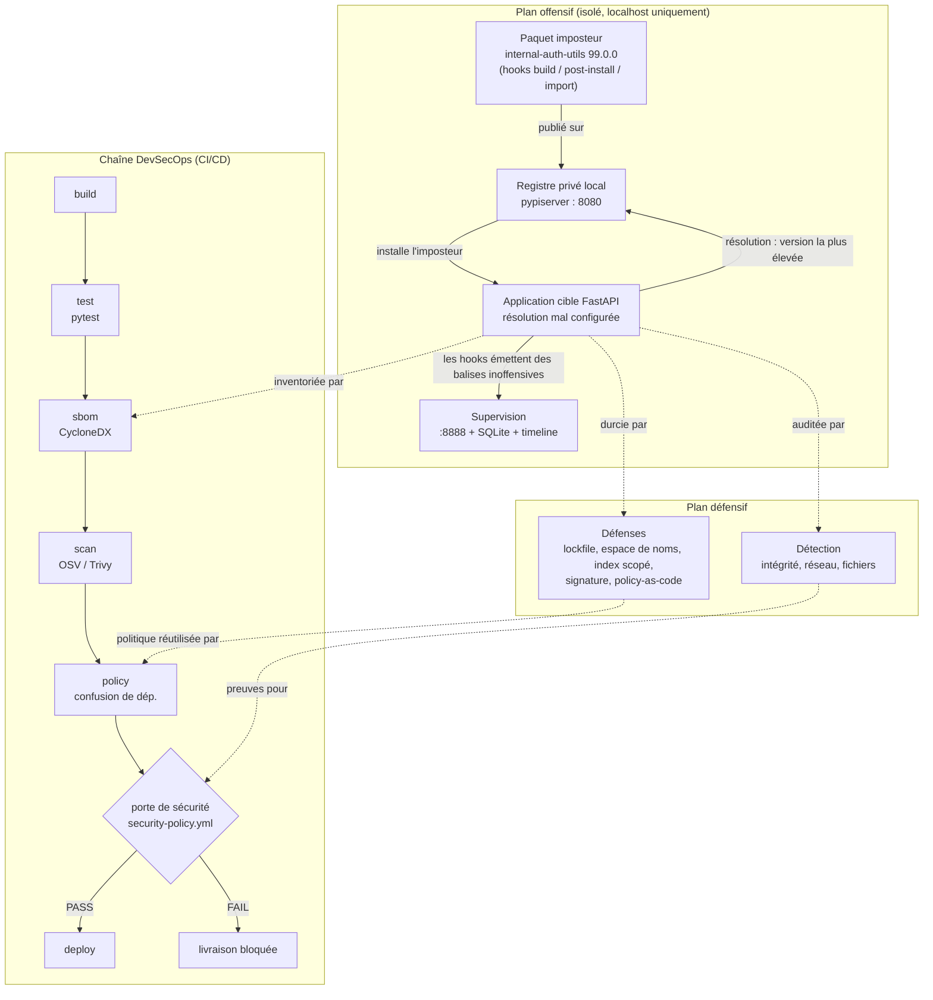

# Laboratoire de sécurité de la chaîne d'approvisionnement logicielle


Laboratoire pédagogique, **entièrement local**, qui reproduit de bout en bout une
attaque par **confusion de dépendances** (*dependency confusion*), puis la détecte,
la prévient et, enfin, la bloque automatiquement au sein d'une chaîne DevSecOps.

Le projet couvre volontairement les deux faces du métier : le volet **offensif**
(la simulation contrôlée de l'attaque) et le volet **défensif** (détection,
durcissement, inventaire logiciel, analyse de vulnérabilités et porte de sécurité
intégrée à la CI/CD). L'objectif n'est pas de produire un outil d'attaque, mais de
démontrer une compréhension complète du vecteur et, surtout, des contre-mesures.

> **Avertissement et périmètre éthique.** Tous les composants réseau sont épinglés
> sur la boucle locale `127.0.0.1`. Rien n'est jamais publié sur un registre réel.
> Le paquet de démonstration ne collecte que des métadonnées système non sensibles
> (nom d'hôte, nom d'utilisateur, version de Python, répertoire courant) et les
> envoie à un serveur de supervision sur `localhost`. Il ne lit aucun secret, ne
> contacte jamais Internet et ne persiste rien en dehors du dépôt. Un test unitaire
> (`tests/test_demo_package_is_benign.py`) vérifie en continu que la charge utile
> reste inoffensive.

---

## Sommaire

- [Contexte et objectifs](#contexte-et-objectifs)
- [Le vecteur d'attaque en bref](#le-vecteur-dattaque-en-bref)
- [Architecture](#architecture)
- [Technologies utilisées](#technologies-utilisées)
- [Installation](#installation)
- [Configuration](#configuration)
- [Fonctionnement](#fonctionnement)
- [Démonstration](#démonstration)
- [Aspects de sécurité](#aspects-de-sécurité)
- [Tests](#tests)
- [Intégration continue](#intégration-continue)
- [Structure du dépôt](#structure-du-dépôt)
- [Pistes d'amélioration](#pistes-damélioration)
- [Usage responsable](#usage-responsable)
- [Licence](#licence)

---

## Contexte et objectifs

La confusion de dépendances est l'un des vecteurs d'attaque les plus marquants de
la sécurité logicielle moderne. En 2021, le chercheur Alex Birsan a démontré qu'en
publiant sur un registre public des paquets portant le **nom de bibliothèques
internes** d'entreprises, il parvenait à faire exécuter son code sur les
infrastructures d'Apple, Microsoft, PayPal et une trentaine d'autres organisations.
Aucune victime n'avait tapé un nom malveillant : une simple configuration de
résolution trop permissive suffisait.

Ce laboratoire a été conçu pour répondre à une question d'ingénierie précise :
**comment ce mécanisme fonctionne-t-il réellement, et quelles contre-mesures
l'arrêtent, à quelle étape et avec quel niveau de garantie ?** Il poursuit six
objectifs, qui structurent également le code :

1. **Simuler** l'attaque dans un environnement isolé et reproductible.
2. **Analyser** le mécanisme de résolution exploité et les faiblesses associées.
3. **Détecter** l'attaque en Python (contrôle d'intégrité, supervision réseau et
   système de fichiers).
4. **Prévenir** l'attaque (verrouillage et vérification d'empreintes, registres
   à portée restreinte, réservation de l'espace de noms, vérification de
   signature, *policy-as-code*).
5. **Automatiser** ces contrôles dans une CI/CD afin de bloquer une livraison dès
   qu'une vérification de sécurité échoue.
6. **Documenter** une matrice attaque / défense ainsi que trois briques DevSecOps
   personnelles : génération de SBOM CycloneDX, analyse de CVE via OSV, et une
   porte de sécurité configurable.

## Le vecteur d'attaque en bref

Un gestionnaire de paquets doit répondre à une question simple : *pour le nom
`internal-auth-utils`, quelle distribution installer ?* Lorsqu'il est configuré
pour consulter **plusieurs index** et retenir la **version la plus élevée**
(comportement historique de `pip`, activé dans `uv` par l'option
`index-strategy = "unsafe-best-match"`), il suffit à un attaquant de publier une
**version supérieure sous le même nom** sur n'importe quel index de confiance pour
que son artefact soit sélectionné, construit et installé. L'exécution de code
survient alors via les *hooks* d'installation (`setup.py`) ou les effets de bord
à l'import.

Dans ce laboratoire, le registre privé local joue le rôle de l'index sur lequel
l'attaquant a réussi à déposer son paquet. La bibliothèque interne légitime est
supposée exister en version `1.4.2` ; l'imposteur est publié en version `99.0.0`,
numéro volontairement démesuré pour **remporter la résolution**.

## Architecture

Le laboratoire s'organise en deux plans complémentaires : un plan **offensif**,
qui met en scène l'attaque en vase clos, et un plan **défensif / DevSecOps**, qui
la détecte, la prévient et l'arrête au niveau de la livraison.



Les diagrammes détaillés (vue système et flux de données dans le pipeline) sont
disponibles dans [`docs/ARCHITECTURE.md`](docs/ARCHITECTURE.md).

## Technologies utilisées

| Domaine | Outils et bibliothèques | Rôle dans le projet |
|---|---|---|
| Application et API | FastAPI, Uvicorn, Jinja2 | Application cible vulnérable, serveur de supervision, console web |
| Registre privé | pypiserver | Index local jouant le rôle de l'index abusé par l'attaquant |
| Packaging | `build`, `twine`, `uv` / `pip` | Construction de la sdist imposteur et résolution réaliste |
| Détection | Scapy, Watchdog | Supervision réseau (capture de paquets) et système de fichiers |
| SBOM | CycloneDX (`cyclonedx-bom`) | Inventaire logiciel au format CycloneDX 1.5 |
| Vulnérabilités | OSV (API), Trivy (optionnel) | Corrélation des composants avec les CVE connues |
| Politique | PyYAML | Chargement de la *policy-as-code* de la porte de sécurité |
| Tests | pytest | Suite de 30 tests hors ligne |
| CI/CD | GitLab CI, GitHub Actions | Automatisation de la chaîne et blocage de la livraison |
| Confort CLI | Rich | Affichage narré de la démonstration |

L'ensemble cible **Python 3.9 ou supérieur**.

## Installation

```bash
python -m venv .venv && source .venv/bin/activate   # Windows : .venv\Scripts\activate
pip install -r requirements.txt
pip install uv            # recommandé, pour une résolution de dépendances réaliste
```

Remarques utiles :

- Le superviseur réseau (`detection/network_monitor.py`) repose sur Scapy et
  requiert des privilèges d'accès aux sockets bruts. En l'absence de ces droits,
  il bascule automatiquement sur un mode d'analyse des journaux, ce qui permet au
  laboratoire de fonctionner sans `sudo`.
- `uv` est optionnel : sans lui, l'étape d'attaque retombe sur `pip`.
- La génération de SBOM transitif (`--real`) nécessite `cyclonedx-bom`, inclus
  dans `requirements.txt`.

## Configuration

La configuration se concentre en deux endroits lisibles :

- **`scsim/config.py`** centralise les constantes du laboratoire : chemins, nom et
  versions du paquet imposteur, préfixes considérés comme internes, et surtout les
  points d'accès réseau, tous épinglés sur `127.0.0.1`. Les ports sont surchargés
  par variables d'environnement (`SCSIM_REGISTRY_PORT`, port `8080` par défaut ;
  `SCSIM_MONITOR_PORT`, port `8888` par défaut).
- **`security/security-policy.yml`** décrit la politique appliquée par la porte de
  sécurité. Elle est volontairement déclarative afin qu'une équipe puisse ajuster
  la rigueur sans toucher au code :

```yaml
rules:
  require_sbom: true                     # un SBOM CycloneDX valide est obligatoire
  dependency_confusion:
    fail_on_unscoped_internal: true      # échoue si un nom interne peut résoudre en public
    audit_paths:
      - target-app/pyproject.toml
  cve:
    fail_on_severity: HIGH               # bloque à partir de HIGH
    per_severity_max:                    # plafonds par sévérité
      CRITICAL: 0
      HIGH: 0
      MEDIUM: 10
    allowlist: []                        # CVE tolérées, avec justification documentée
    fail_on_scan_errors: false           # traiter une erreur de scan comme un échec
```

La configuration vulnérable, elle, se trouve dans `target-app/pyproject.toml` :
l'index privé est bien déclaré, mais PyPI reste un index de repli **et** la
stratégie `unsafe-best-match` autorise la sélection de la version la plus élevée
tous index confondus. Cette combinaison est exactement la faille.

## Fonctionnement

### Côté attaque

| Étape | Commande | Effet |
|---|---|---|
| Registre | `python -m scsim.runner registry` | Démarre pypiserver sur `:8080` |
| Supervision | `python -m scsim.runner monitor` | Démarre la console web sur `:8888` |
| Publication | `python -m scsim.runner publish` | Construit la sdist imposteur et la dépose sur le registre local |
| Attaque | `python -m scsim.runner attack` | Installe l'application cible ; les hooks de l'imposteur s'exécutent |

La sdist imposteur exécute du code à trois moments observables, ce qui illustre la
surface d'exécution d'un paquet : au **build** (commande `build_py` de
`setup.py`), à la **post-installation** (commande `install` personnalisée) et à
l'**import** du module. Chacun émet une balise inoffensive vers le superviseur,
si bien qu'une seule ligne de dépendance négligente produit plusieurs exécutions.

### Côté défense

| Étape | Commande | Effet |
|---|---|---|
| Détection | `python -m scsim.runner detect` | Lance les trois détecteurs |
| Défense | `python -m scsim.runner defend` | Teste les cinq défenses contre l'attaque |
| SBOM | `python -m security.sbom` | Génère l'inventaire CycloneDX |
| Scan CVE | `python -m security.cve_scan` | Corrèle les composants avec OSV |
| Porte de sécurité | `python -m security.gate` | Rend un verdict et un code de sortie CI |
| Rapport | `python -m scsim.runner report` | Régénère la matrice attaque / défense |

L'orchestrateur `python -m scsim.runner run` enchaîne l'ensemble. L'option
`--narrated` ajoute une pause pédagogique et une explication à chaque étape ;
`--simulate` déclenche directement les hooks (sans `uv` ni réseau) pour un
fonctionnement hors ligne.

## Démonstration

### Déroulé narré complet

```bash
python -m scsim.runner run --narrated            # démonstration guidée de bout en bout
python -m scsim.runner run --narrated --simulate # variante hors ligne
```

Ouvrez ensuite la console web pour visualiser les événements :

| Vue | URL | Contenu |
|---|---|---|
| Moniteur d'attaque | `http://127.0.0.1:8888/` | Les balises émises par l'imposteur |
| Timeline | `http://127.0.0.1:8888/timeline` | La séquence build puis installation puis import |
| Console de sécurité | `http://127.0.0.1:8888/security` | Verdict de la porte, tableau des CVE (badges de sévérité, graphe en anneau, filtres, recherche, tri) et SBOM |

### La chaîne DevSecOps en trois commandes

```bash
python -m security.sbom        # 1. SBOM CycloneDX
python -m security.cve_scan    # 2. analyse OSV du SBOM
python -m security.gate        # 3. porte de sécurité (code de sortie 1 = livraison bloquée)
```

Avec la configuration vulnérable fournie, la porte **bloque** la livraison :

```text
==================== SECURITY GATE ====================
  PASS   require_sbom            valid CycloneDX
  FAIL   dependency_confusion    2 critical finding(s)
  FAIL   cve                     ... >= HIGH
-------------------------------------------------------
  DELIVERY BLOCKED
=======================================================
```

Corriger la configuration de l'application cible (restreindre le nom interne à
l'index privé, retirer `unsafe-best-match`, voir `defenses/scoped_registry.py`)
fait repasser la règle au vert. Ce basculement rouge / vert est précisément ce que
le pipeline est censé démontrer.

> Le mode `python -m security.cve_scan --demo` interroge OSV sur un jeu de
> versions anciennes volontairement vulnérables (sans les installer ni les
> utiliser) afin de montrer le scanner remonter de vraies CVE.

## Aspects de sécurité

Le cœur du projet est défensif. Il s'articule autour de trois mécanismes de
détection, cinq défenses préventives et une porte de sécurité.

### Détection

| Détecteur | Principe | Portée et limites |
|---|---|---|
| Intégrité (`hash_check`) | Compare la version et l'empreinte SHA-256 de l'artefact résolu à un *lockfile* de référence | Déterministe : refuse l'échange sans observer de comportement. Signal le plus fort |
| Réseau (`network_monitor`) | Signale toute connexion sortante inattendue pendant l'installation | Capture Scapy (privilèges requis), sinon mode journal. Détecte le « rappel au serveur » |
| Système de fichiers (`filesystem_monitor`) | Détecte l'accès à des chemins sensibles pendant l'installation | Watchdog observe les mutations, pas les lectures pures. Capte l'intention de collecte via des fichiers canari |

La superposition est volontaire : le contrôle d'intégrité arrête les échanges de
version connus, tandis que la supervision réseau et fichiers capte des charges
inédites qui passeraient un épinglage oublié.

### Défenses préventives

| Défense | Étape d'action | Garantie apportée |
|---|---|---|
| Verrouillage et empreintes (`lockfile_pinning`) | build / install | Refuse tout artefact dont la version ou l'empreinte ne correspond pas au pin |
| Réservation d'espace de noms (`namespace_reservation`) | publication | Empêche l'attaquant de revendiquer le nom interne sur l'index public |
| Registre à portée restreinte (`scoped_registry`) | résolution | Lie chaque nom interne à un index privé explicite ; l'index public n'est jamais consulté pour ces noms |
| Vérification de signature (`signing_verification`) | install | Rejette tout artefact non signé par la clé de publication de confiance (Ed25519, repli HMAC) |
| Policy-as-code (`policy_scanner`) | pré-commit / CI | Échoue sur une configuration qui laisse un nom interne résoudre en public, avant toute installation |

Les défenses qui agissent **tôt** (réservation, registre scopé, analyse de
politique) sont préférables, car elles empêchent la sélection de l'imposteur ;
celles qui agissent plus **tard** (empreintes, signature) restent décisives
puisqu'elles refusent les octets installés. La défense en profondeur combine un
contrôle préventif précoce et un contrôle vérificateur tardif.

### Briques DevSecOps

- **SBOM (CycloneDX 1.5)** : `security/sbom.py` inventorie les dépendances au
  format CycloneDX (chaque composant porte un `purl` `pkg:pypi/...`) et marque les
  noms d'allure interne. Le générateur intégré (dépendances directes, sans
  dépendance supplémentaire) est le mode par défaut ; `--real` bascule sur l'outil
  officiel `cyclonedx-py` pour l'arbre **transitif** complet, et
  `--real --requirements <fichier épinglé>` ajoute les **empreintes** d'artefacts
  (provenance de niveau SLSA).
- **Analyse de CVE (OSV / Trivy)** : `security/cve_scan.py` interroge la base OSV
  pour chaque composant, normalise la sévérité en calculant le score de base CVSS
  v3.1 à partir du vecteur, déduplique les alias (PYSEC, GHSA, CVE) et produit un
  rapport JSON. Le transport réseau est injectable, ce qui rend le scanner
  testable hors ligne ; `--trivy` délègue à l'outil Trivy.
- **Porte de sécurité configurable** : `security/gate.py` lit
  `security-policy.yml` (seuil de sévérité CVE, plafonds par sévérité, liste
  d'exceptions justifiées, règle de confusion de dépendances, exigence de SBOM) et
  renvoie un code de sortie exploitable en CI.

### Correspondance avec les référentiels

Les défenses se rattachent directement à deux référentiels reconnus :

- **SLSA** : artefacts signés et provenance (vérification de signature), builds
  reproductibles et épinglés par empreinte (verrouillage).
- **NIST SSDF (SP 800-218)** : pratiques PW.4 (ne réutiliser que des composants
  sûrs), PS.2 / PS.3 (protéger et vérifier l'intégrité), PO.3 (sécurité de la
  chaîne d'outils, *policy-as-code* et contrôle de l'egress en build).

## Tests

```bash
pytest -q
```

La suite compte **30 tests**, tous **hors ligne** : le transport OSV est remplacé
par un transport factice à vulnérabilités prédéfinies, et aucun test ne contacte
Internet. Elle couvre le garde-fou de non-nocivité de la charge utile, les trois
détecteurs, les cinq défenses, la génération et la validation du SBOM, l'analyse
de CVE (y compris le calcul de score CVSS et la déduplication), la porte de
sécurité (blocage attendu selon la politique) et les routes du superviseur.

## Intégration continue

La chaîne est fournie pour **GitLab CI** (`.gitlab-ci.yml`) et **GitHub Actions**
(`.github/workflows/ci.yml`), selon le même enchaînement :

```text
build -> test -> sbom -> scan (OSV, Trivy optionnel) -> policy -> porte de sécurité -> deploy
```

Particularité assumée : l'application cible de ce laboratoire étant
**volontairement vulnérable**, la porte de sécurité **doit** bloquer la livraison.
Le pipeline est donc considéré comme vert lorsque la porte **bloque correctement**
cette application (c'est la démonstration) et que tous les tests passent. Dans un
projet réel en aval, on laisserait au contraire un code de sortie non nul faire
échouer le pipeline et interrompre le déploiement. Le SBOM et le rapport CVE sont
publiés comme artefacts de pipeline.

## Structure du dépôt

```text
.
├── packages/internal-auth-utils/   # paquet imposteur de démonstration (inoffensif)
├── target-app/                     # application FastAPI volontairement vulnérable
│   └── RESOLUTION_WALKTHROUGH.md    # explication pas à pas de la résolution
├── monitoring/                     # superviseur web (FastAPI + SQLite) et console de sécurité
├── detection/                      # détecteurs : intégrité, réseau, système de fichiers
├── defenses/                       # cinq défenses préventives + scanner de politique
├── security/                       # DevSecOps : SBOM, scan CVE, porte de sécurité
│   ├── sbom.py                     #   générateur CycloneDX 1.5
│   ├── cve_scan.py                 #   scanner OSV / Trivy
│   ├── gate.py                     #   porte de sécurité configurable
│   └── security-policy.yml         #   règles de la porte (policy-as-code)
├── scsim/                          # orchestrateur CLI de la démonstration
├── report/                         # rapport d'analyse généré (matrice attaque / défense)
├── tests/                          # suite pytest hors ligne
├── docs/ARCHITECTURE.md            # diagrammes d'architecture et de flux (Mermaid)
├── .github/workflows/ci.yml        # pipeline GitHub Actions
├── .gitlab-ci.yml                  # pipeline GitLab CI
└── requirements.txt
```

## Pistes d'amélioration

Plusieurs extensions prolongeraient naturellement le travail :

- **Scoring CVSS v4** : le calcul de score intégré couvre CVSS v3.1 ; les rares
  entrées OSV ne fournissant qu'un vecteur v4 restent classées `UNKNOWN`.
- **Signature réelle** : remplacer la clé Ed25519 locale par une intégration
  Sigstore / PEP 740 (attestations de provenance) et un service de gestion de clés.
- **Réservation d'espace de noms en pratique** : automatiser l'inventaire des noms
  internes et leur réservation proactive (y compris via les espaces de noms
  d'organisation de PyPI).
- **Analyse d'images de conteneurs** : étendre la chaîne SBOM + scan aux images
  Docker (par exemple avec Trivy ou Syft).
- **Détection des lectures de secrets** : compléter Watchdog par la couche d'audit
  du système d'exploitation (auditd / eBPF sous Linux) pour détecter les lectures,
  et pas seulement les mutations de fichiers.

## Usage responsable

Ce laboratoire est un environnement défensif contrôlé. Il ne doit jamais servir à
cibler un système dont on n'est pas propriétaire ou pour lequel on n'a pas
d'autorisation écrite. L'étape de publication ne doit jamais viser un autre
registre que l'instance locale fournie, et la fonction de collecte de métadonnées
ne doit en aucun cas être réutilisée dans un paquet distribué. La section
consacrée à la divulgation responsable et aux limites éthiques de la recherche en
sécurité de la chaîne d'approvisionnement figure dans
[`report/analysis_report.md`](report/analysis_report.md).

## Licence

Projet distribué sous licence **MIT**. Voir le fichier [`LICENSE`](LICENSE).
