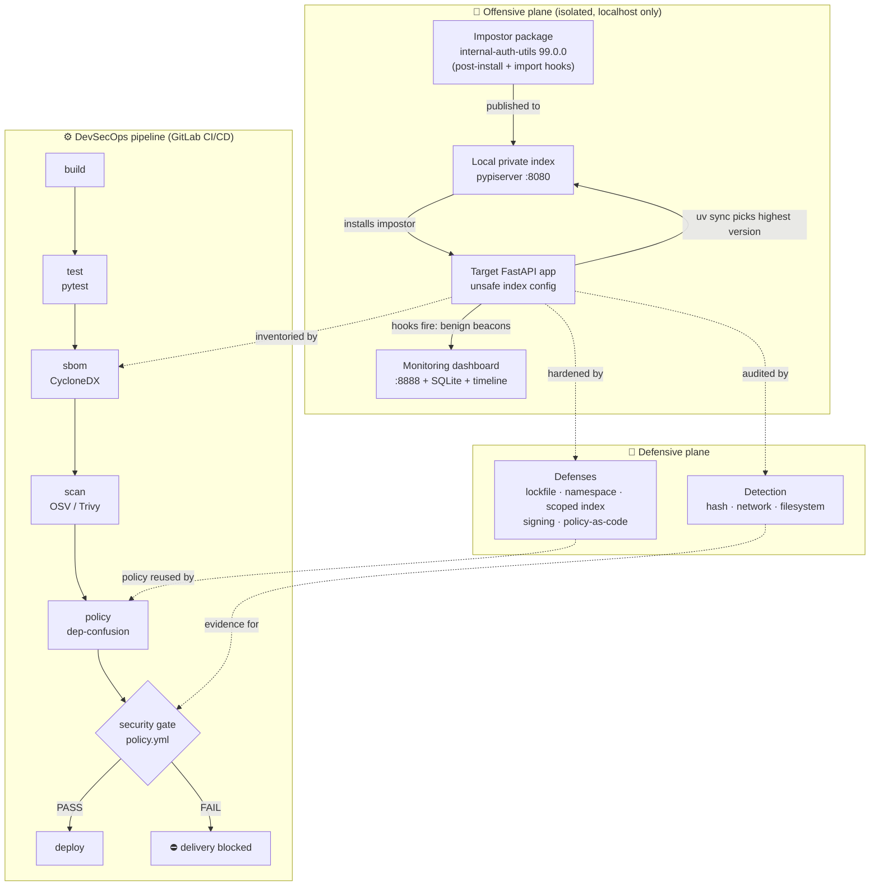
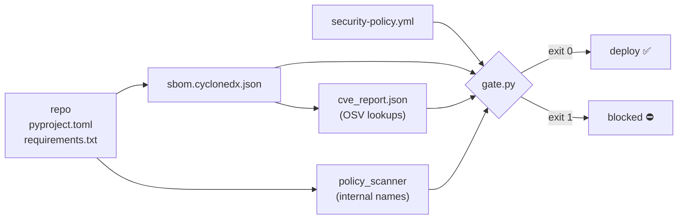

# Architecture

The lab has two planes — an **offensive** plane that stages a dependency
confusion attack in isolation, and a **defensive / DevSecOps** plane that
detects it, prevents it, and enforces security as a gate on delivery.

## System overview



## Data flow through the pipeline



## Components

| Layer | Path | Responsibility |
|---|---|---|
| Registry | `scripts/`, runner | Local private index (pypiserver) |
| Impostor | `packages/internal-auth-utils/` | Demonstrates the attack mechanism (benign) |
| Target | `target-app/` | Intentionally vulnerable consumer app |
| Monitor | `monitoring/` | Captures + visualises the "exfil" beacons |
| Detection | `detection/` | Hash, network, filesystem detectors |
| Defenses | `defenses/` | Five preventive controls + policy scanner |
| SBOM | `security/sbom.py` | CycloneDX inventory |
| CVE scan | `security/cve_scan.py` | OSV / Trivy vulnerability lookup |
| Gate | `security/gate.py`, `security-policy.yml` | Configurable delivery gate |
| CI/CD | `.gitlab-ci.yml` | Enforces the chain, blocks deploy on failure |
| Orchestrator | `scsim/runner.py` | One-command narrated demo |
| Tests | `tests/` | Offline pytest suite |
```
