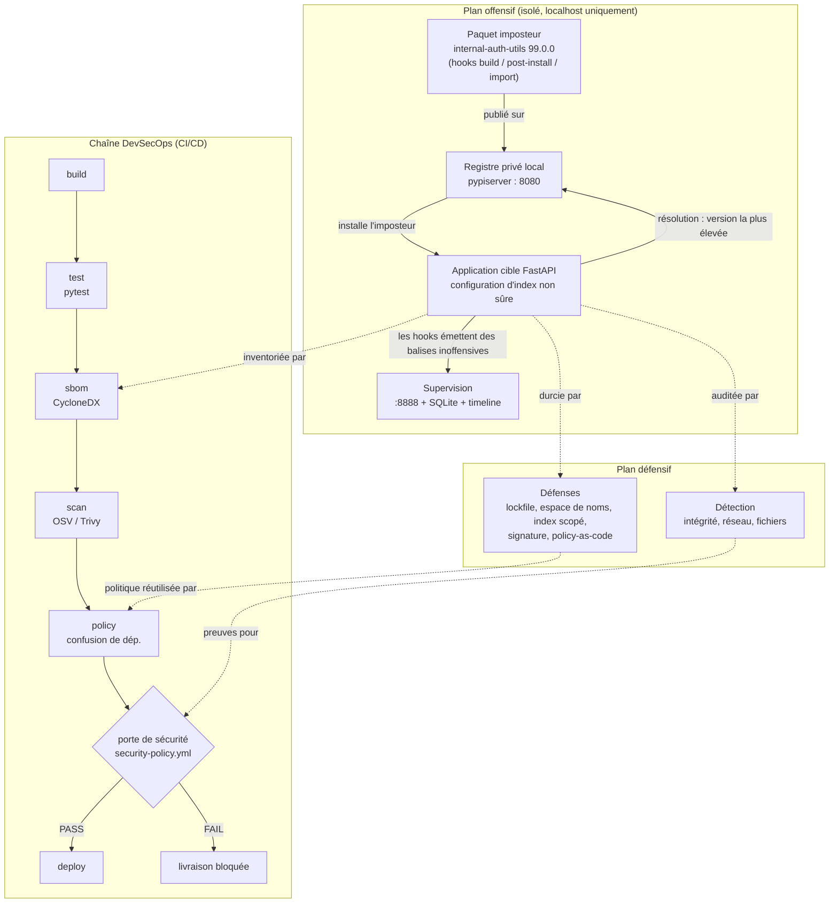
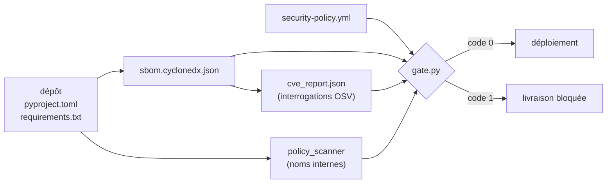
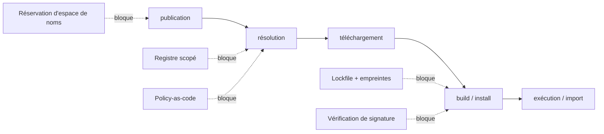

# Architecture

Le laboratoire s'organise en deux plans complémentaires : un plan **offensif**,
qui met en scène l'attaque par confusion de dépendances en vase clos, et un plan
**défensif / DevSecOps**, qui la détecte, la prévient et l'arrête au niveau de la
livraison.

## Vue système

## Flux de données dans le pipeline

## À quelle étape chaque défense agit

L'attaque progresse de gauche à droite, de la publication à l'exécution. Plus une
défense agit tôt, meilleure est la garantie, puisque l'imposteur n'est même pas
sélectionné.

## Composants

| Couche | Chemin | Responsabilité |
|---|---|---|
| Registre | `scsim/runner.py` | Index privé local (pypiserver) |
| Imposteur | `packages/internal-auth-utils/` | Démontre le mécanisme d'attaque (inoffensif) |
| Cible | `target-app/` | Application consommatrice volontairement vulnérable |
| Supervision | `monitoring/` | Capture et visualise les balises, console de sécurité |
| Détection | `detection/` | Détecteurs intégrité, réseau, système de fichiers |
| Défenses | `defenses/` | Cinq contrôles préventifs et scanner de politique |
| SBOM | `security/sbom.py` | Inventaire CycloneDX |
| Scan CVE | `security/cve_scan.py` | Corrélation OSV / Trivy |
| Porte | `security/gate.py`, `security/security-policy.yml` | Porte de livraison configurable |
| CI/CD | `.gitlab-ci.yml`, `.github/workflows/ci.yml` | Enchaîne la chaîne et bloque le déploiement en cas d'échec |
| Orchestrateur | `scsim/runner.py` | Démonstration narrée en une commande |
| Tests | `tests/` | Suite pytest hors ligne |
